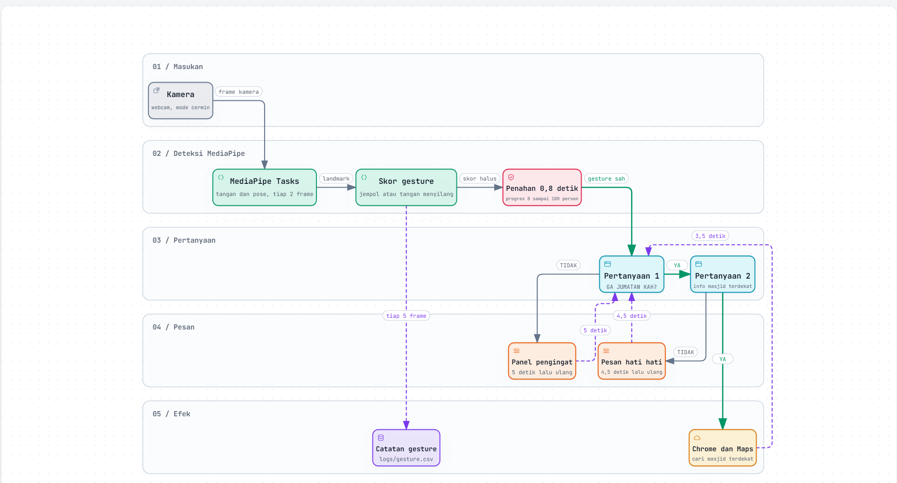

# GA JUMATAN KAH?



Program tanya jawab lucu memakai webcam. Kamera menjadi "video" yang menjawab
pertanyaan di layar lewat gesture tangan.

## Alur permainan

1. Layar menampilkan pertanyaan pertama: **GA JUMATAN KAH?**
   * Jempol berarti YA, lanjut ke pertanyaan kedua.
   * Tangan menyilang berarti TIDAK, muncul panel pengingat selama 5 detik,
     lalu program kembali ke awal.
2. Layar menampilkan pertanyaan kedua: **MAU INFO MASJID TERDEKAT?**
   * Jempol berarti YA, Chrome dibuka ke Google Maps dengan pencarian masjid terdekat.
   * Tangan menyilang berarti TIDAK, muncul pesan agar berhati hati di jalan.

Setiap jawaban harus ditahan sekitar 0.8 detik, ditandai lingkaran progres 0 sampai
100 persen. Setelah menjawab, Anda harus kembali ke posisi netral dulu supaya pose
yang sama tidak menjawab dua kali.

## Cara menjalankan

1. Klik dua kali `run.bat`.
   * Saat pertama dijalankan, script ini membuat folder `.venv` lalu memasang
     `mediapipe` dan `pygame`. Butuh internet, cukup sekali.
   * Model MediaPipe di folder `models` juga diunduh otomatis pada saat itu.
2. Izinkan akses kamera kalau Windows bertanya.
3. Program tampil fullscreen. Tekan **ESC** untuk keluar.

Kebutuhan: Python 3.11 atau lebih baru dan Google Chrome untuk membuka Maps.

## Kontrol keyboard

* **ESC** atau **Q** keluar dari program.
* **F1** mode debug: menampilkan landmark, skor jempol, dan kondisi tangan
  menyilang mana yang belum terpenuhi.
* **Y** memaksa jawaban YA, untuk menguji alur tanpa gesture.
* **N** memaksa jawaban TIDAK, untuk menguji alur tanpa gesture.

## Opsi command line

```bat
run.bat --window                  jendela 1280x720, bukan fullscreen
run.bat --debug                   langsung masuk mode debug
run.bat --source assets\ga_jumatan.png   gambar atau video pengganti kamera
run.bat --shot cek.png            simpan satu screenshot lalu keluar
run.bat --state maps              paksa mulai di tahap tertentu
```

## Cara program membaca gesture

**Jempol (YA)** memakai Hand Landmarker dari MediaPipe. Tiga syaratnya:

1. ujung jempol mengarah ke atas, sudutnya kurang dari sekitar 35 derajat dari garis
   vertikal;
2. jempol terentang, ujungnya berada di atas sendi IP dan MCP;
3. minimal 3 dari 4 jari lain terlipat ke telapak.

**Tangan menyilang di dada (TIDAK)** memakai Pose Landmarker dari MediaPipe. Syaratnya:

1. bahu, siku, dan pergelangan terlihat jelas;
2. posisi kiri kanan kedua pergelangan terbalik dibanding posisi bahu, jadi benar
   benar menyilang;
3. kedua pergelangan berdekatan, menumpuk di depan dada;
4. tinggi pergelangan berada di area dada;
5. kedua siku menekuk dan lengan bawah kira kira mendatar.

Kalau salah satu kondisi belum terpenuhi, tekan **F1**. Baris `silang:` akan
menunjukkan kondisi mana yang masih gagal, jadi mudah disetel.

## Menyetel

Semua angka pengaturan ada di `config.py`.

* Durasi dan progres
  * `HOLD_SECONDS` berapa lama gesture harus ditahan, default 0.8 detik
  * `GATE_DECAY` kalau pose hilang sesaat, progres turun perlahan, bukan langsung nol
  * `GESTURE_SMOOTHING` perataan skor antar frame, nilai 0 sampai 1
  * `NEUTRAL_SECONDS` wajib netral berapa lama sebelum jawaban berikutnya
  * `REMINDER_SECONDS` lama panel pengingat tampil
  * `HATI_HATI_SECONDS` lama pesan hati hati tampil
  * `MAPS_MESSAGE_SECONDS` lama pesan pembukaan Maps tampil
* Kamera dan tampilan
  * `CAMERA_INDEX` ubah ke 1 kalau kamera yang dipakai bukan kamera utama
  * `MIRROR` nilai True membuat tampilan seperti cermin
  * `POSE_MODEL` pilihan `lite`, `full`, atau `heavy`, yaitu akurasi lawan kecepatan
* Teks dan tujuan Maps
  * `TEXT_*` semua teks yang muncul di layar
  * `MAPS_URL` alamat yang dibuka Chrome, default pencarian masjid terdekat
* Ambang deteksi
  * `THUMB_*` ambang deteksi jempol
  * `CROSS_*` ambang deteksi tangan menyilang
* Diagnosa
  * `LOG_GESTURES` catat skor tiap frame ke `logs\gesture.csv`

Kalau tangan menyilang susah terbaca:

* pastikan seluruh badan, dari bahu sampai pinggang, masuk frame;
* cahaya cukup, jangan membelakangi jendela;
* pakai lengan pendek atau lengan baju yang tidak terlalu longgar;
* cek `logs\gesture.csv`. Kolom `terbalik` harus bernilai 1, kolom `jarak` di bawah
  1.1, dan kolom `tinggi` berada di antara `batas_atas` dan `batas_bawah`. Kolom
  `silang` adalah skor mentah, sedangkan `silang_halus` adalah skor setelah diratakan.

Contoh isi log yang normal saat tangan menyilang:

```
waktu,state,gesture,jempol,silang,silang_halus,terlihat,terbalik,jarak,tinggi
13:21:35,tanya_1,TIDAK,0.00,1.00,0.86,6.0,1.0,0.83,0.83
```

Kalau jempol susah terbaca, turunkan `THUMB_MIN_VERTICAL` ke 0.45 dan
`THUMB_MIN_FOLDED_FINGERS` ke 2.

## Struktur folder

```
app.py                  loop utama dan alur tahap
config.py               semua pengaturan dan ambang
run.bat                 peluncur otomatis, membuat venv, memasang, menjalankan
requirements.txt        dependensi Python
assets                  gambar panel pertanyaan dan panel pengingat
models                  model MediaPipe, diunduh otomatis, jangan dihapus
src                     kamera, UI, maps, detektor, dan logika gesture
tests                   uji logika gesture tanpa kamera
```

Uji logika tanpa kamera:

```bat
.venv\Scripts\python.exe tests\test_gestures.py
```

## Catatan

* Google Maps dibuka lewat Chrome ke alamat pencarian masjid terdekat. Lokasi
  ditentukan Google dari perangkat atau jaringan Anda, jadi akurasinya tergantung izin
  lokasi Windows dan koneksi internet.
* Bagian atas layar menampilkan kamera Anda sendiri dalam mode cermin supaya gesture
  terlihat langsung. Itulah "video" yang menjawab pertanyaan.
* Program ini lelucon dan pengingat, bukan pengganti jadwal salat resmi.
